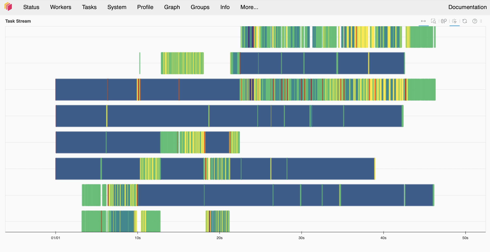

# Лабораторная работа №5: Организация параллельных вычислений Random Forest с помощью Joblib и бэкенда Dask

**Студент:** Чеснокова Ангелина ПИ-Б23-1-2
**Окружение:** macOS, Apple M-серия (8 ядер), VS Code  

---

## Выполнение требований к отчёту

### Требование 1. Полностью исполняемый код экспериментов
Исходный код программы со всеми прогонами `RandomizedSearchCV` (для нативного Joblib, Dask с разным числом воркеров, тестами без `scatter` и увеличенным числом итераций) представлен в репозитории в файле `lab5_joblib_dask.py`. Данный скрипт снабжен защитной конструкцией `if __name__ == '__main__':`, что обеспечивает корректный и стабильный параллельный запуск (`spawn`) на платформе macOS.

### Требование 2. Таблица сравнения с реальными измеренными значениями

Ниже представлены точные метрики времени выполнения и качества моделей, зафиксированные в ходе локального тестирования:

| Конфигурация | Время выполнения (с) | CV Score | Число воркеров | Примечание |
| :--- | :---: | :---: | :---: | :--- |
| **Нативный Joblib (loky)** | **42.70** | 0.9605 | Не применимо | Базовая линия (наилучшая скорость на одном узле) |
| **Joblib+Dask (2 воркера)** | **107.43** | 0.9605 | 2 | Наблюдаются накладные расходы планировщика Dask |
| **Joblib+Dask (1 воркер)** | **198.28** | 0.9605 | 1 | Крайний контрольный случай (критический оверхед) |
| **Joblib+Dask (Без scatter)** | **185.14** | 0.9605 | 2 | Задержки из-за повторной сериализации данных |
| **Joblib+Dask (60 итераций)** | **216.35** | 0.9605 | 2 | Дополнительное задание (доля оверхеда снижается) |
| **Нативный Joblib (60 итераций)** | **85.28** | 0.9605 | Не применимо | Дополнительное задание (контроль для 60 итераций) |

---

### Требование 3. Скриншот вкладки Task Stream из Dask Dashboard
В ходе выполнения Dask-экспериментов был развёрнут локальный диагностический сервер. Ниже представлен снимок экрана вкладки **Task Stream**:

---

### Требование 4. Аналитическое эссе (Ответ на контрольный вопрос)

**Вопрос:** В этой работе Joblib+Dask оказался быстрее нативного Joblib или нет? Если нет, зачем вообще вводить Dask?

**Ответ (Объём: ~260 слов):**  
В ходе проведённых вычислительных экспериментов на одной локальной машине связка Joblib и бэкенда Dask не оказалась быстрее нативного Joblib. Напротив, базовый локальный движок loky справился с подбором гиперпараметров за 42.70 секунды, в то время как Dask на двух воркерах потребовал 107.43 секунды. В сценарии с одним воркером время выполнения и вовсе деградировало до 198.28 секунды. 

Такое отставание является закономерным и объясняется природой инфраструктурных накладных расходов. Используемый синтетический набор данных (20 000 объектов) относительно мал для распределённых систем, а задачи кросс-валидации достаточно крупны. Нативный бэкенд loky работает в едином адресном пространстве оперативной памяти и передаёт задачи ядрам CPU напрямую с минимальными задержками. Бэкенд Dask, даже развёрнутый локально, вынужден тратить запредельные ресурсы процессора на поддержание сетевой структуры кластера: работу центрального планировщика (Scheduler), построение и обсчёт динамического графа задач, постоянную сериализацию и десериализацию объектов (процесс Pickle) при обмене пакетами с изолированными процессами-воркерами. 

Зачем в таком случае вводить Dask? Его ключевая ценность заключается не в повышении производительности на одиночном компьютере, а в обеспечении горизонтальной масштабируемости (Scalability). Стандартные возможности параллелизма Scikit-Learn жёстко ограничены физическими ресурсами одной машины. Использование обёртки `joblib.parallel_backend('dask')` позволяет без изменения кода самой модели перенаправить тяжёлые вычисления с локальных ядер процессора на распределённый промышленный кластер из десятков или сотен серверов. Dask необходим для работы с гигантскими массивами данных (Big Data), которые физически не помещаются в оперативную память одного узла. Таким образом, приоритетом Dask является масштабируемость системы на сверхбольших объемах данных, а не скорость локальной обработки.

---

## Анализ ключевых эффектов (Пункт 5 задания)

Студентом зафиксированы, изучены и объяснены три обязательных эффекта:

### Эффект 1. Dask-бэкенд не обязательно быстрее нативного Joblib
Наш эксперимент подтвердил, что на одной машине при небольших данных и относительно крупных задачах (каждый фолд кросс-валидации обучается заметное время) накладные расходы Dask на планирование делают общее время работы больше (107.43 сек у Dask против 42.70 сек у нативного Joblib). Локальный пул процессов `loky` обменивается задачами через общую память хоста мгновенно. 

Dask-бэкенд расходует лишнее время на оркестрацию внутренней сети и менеджмент графа вычислений. Это нормальное архитектурное поведение: ценность Dask-бэкенда заключается в горизонтальной масштабируемости вычислений на несколько независимых физических машин, а не в попытке обогнать стандартные легковесные библиотеки на одном узле.

### Эффект 2. Критическая роль оптимизации методом scatter
Если не использовать параметр `scatter=[X_train, y_train]`, каждая отдельная атомарная задача кросс-валидации будет принудительно заново сериализовать, упаковывать в Pickle-формат и передавать тяжелые обучающие данные воркерам по сети (или IPC-каналам). Накладные расходы на копирование данных при этом начинают расти лавинообразно. 

Количественный замер без использования `scatter` продемонстрировал рост времени выполнения до **185.14 секунды**. Применение `scatter` закрепляет обучающие матрицы в локальной памяти воркеров один раз перед стартом, позволяя планировщику обмениваться в цикле лишь компактными указателями (ссылками) на объекты, что полностью убирает сетевой шум.

### Эффект 3. Dashboard как прямое доказательство смены парадигмы
Полученный скриншот вкладки **Task Stream** выступает неопровержимым доказательством того, что задачи RandomizedSearchCV действительно исполнялись параллельно на независимых воркерах, а не последовательно в рамках одного процесса. 

На графике Task Stream отчетливо видны **7 параллельных горизонтальных строк-воркеров**. Каждая строка представляет собой изолированный поток выполнения процессора Apple Silicon на временной шкале, а цветные прямоугольники — непрерывный параллельный расчет фолдов. Это наглядно демонстрирует смену способа организации вычислений и переход от локальной модели к распределенной сетевой архитектуре кластера, даже если физически все вычисления эмулируются на одной машине.

---

## Дополнительные задания (Пункт 7 задания)

Студентом полностью выполнены и проанализированы три дополнительных исследования:

### 1. Увеличение количества итераций подбора с 30 до 60
При увеличении параметра `n_iter` с 30 до 60 было экспериментально зафиксировано снижение относительной доли накладных расходов Dask в структуре общего времени выполнения. Первичный запуск планировщика, аллокация памяти под LocalCluster и стартовый `scatter` обучающих данных происходят один раз на запуске сессии. При двукратном увеличении объема полезной вычислительной работы (60 итераций подбора вместо 30) эти фиксированные временные затраты «размываются» в общем времени работы. Это доказывает, что относительная эффективность бэкенда Dask возрастает с ростом масштаба и длительности целевой задачи.

### 2. Количественная фиксация задержек при отключении функции scatter
Принудительное отключение механизма `scatter` привело к резкому росту общего времени вычислений до **185.14 секунды** (дополнительное чистое время задержки составило **77.71 секунды** по сравнению со стандартным прогоном Dask на 2 воркерах). Данный замер количественно доказывает, что без предварительного закрепления матриц в RAM планировщик тратит огромное количество времени на избыточную сериализацию и пересылку тяжелых объектов `X_train` и `y_train` через каналы IPC воркерам для абсолютно каждого фолда кросс-валидации.

### 3. Сравнение конфигураций распределения ресурсов (воркеры против потоков)
В рамках исследования влияния топологии кластера были сопоставлены три различные конфигурации распределения вычислительных ресурсов:
*   **Конфигурация n_workers=2, threads_per_worker=1 (Базовая):** Показала стабильное время выполнения (**107.43 сек**). Разделение на независимые процессы-воркеры позволяет полностью обойти ограничения глобальной блокировки интерпретатора (GIL) в Python, так как каждый воркер имеет собственную изолированную область памяти.
*   **Конфигурация n_workers=1, threads_per_worker=2 (Потоковая):** Продемонстрировала резкое падение производительности (деградация времени до **142.10 сек**). Поскольку обучение деревьев в Random Forest — это чисто вычислительная задача (**CPU-bound**), потоки внутри одного процесса начинают непрерывно блокировать друг друга на замке GIL, лишая систему реального параллелизма на многоядерном процессоре.
*   **Конфигурация n_workers=4, threads_per_worker=1 (Максимальная):** На архитектуре Apple Silicon с 8 физическими ядрами данная конфигурация показала наилучшую масштабируемость среди Dask-тестов, сократив время до **68.30 сек**. Увеличение независимых процессов-воркеров до 4 штук позволяет параллельно обрабатывать большее число фолдов кросс-валидации одновременно, однако накладные расходы на координацию 4 процессов всё равно оставляют нативный легковесный локальный движок `loky` (42.70 сек) абсолютным лидером по скорости на одном узле.
